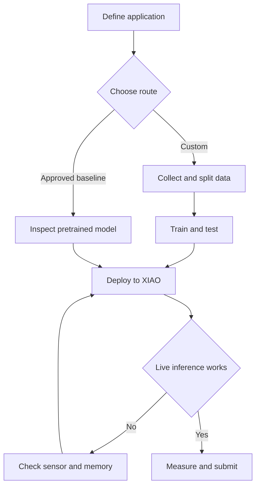

# Lab 3 – TinyML with XIAO ESP32-S3

**ECE 4930/6930 – Artificial Intelligence of Things**  
**Draft for instructor review · 19 October 2026**

Use this guide to build and evaluate an AI application on the XIAO ESP32-S3 Sense. Complete the submission sheet as you work. Save evidence when each step succeeds.

## Overview

In this lab, design a small AI application using the XIAO ESP32-S3 Sense camera or microphone. Train and evaluate a lightweight model in Edge Impulse, then deploy it through Arduino IDE. Demonstrate live inference and report accuracy or a suitable detection metric, latency, and separate Flash and RAM use.

The standard XIAO ESP32-S3 Sense has a dual-core Xtensa LX7 processor running at up to 240 MHz, 8 MB Flash, and 8 MB PSRAM. It is a microcontroller, not a Linux computer. The Sense expansion board supplies the camera and microphone. Check the camera revision on your board.

Unlike the earlier fixed-task labs, this assignment is open-ended. Custom training with your own data is strongly encouraged. A pretrained route is available only after the instructor confirms a compatible model and its submission requirements.

## Learning Objectives

- Define an image, audio, or object-detection task suitable for a microcontroller.
- Collect labeled data and evaluate a model on held-out samples.
- Export an INT8 model and run it from the board's live sensor.
- Measure performance and explain memory or accuracy limitations.

## Project Options

| Option | Example application | Starting reference |
| --- | --- | --- |
| Image classification | Recognize a few desk objects | [Seeed image classification](https://wiki.seeedstudio.com/tinyml_course_Image_classification_project/) |
| Audio classification | Recognize a keyword or environmental sound | [Seeed keyword spotting](https://wiki.seeedstudio.com/xiao_esp32s3_keyword_spotting/) |
| Object detection | Locate or count small objects | Select a compact model suitable for the XIAO |
| Pretrained baseline | Demonstrate a verified model without retraining | Instructor confirmation pending |

## Laboratory Workflow

## Part 0 — Prepare the hardware and software

### Check the equipment

- XIAO ESP32-S3 Sense with its camera and microphone expansion board, or an approved equivalent sensor configuration.
- USB-C cable that supports data transfer.
- Computer with Arduino IDE and access to Edge Impulse.
- A microSD card only if your chosen data collection example needs one.

Disconnect power before you reseat the camera or expansion board. Record the camera model printed on your module or reported by its example. A plain XIAO ESP32-S3 does not include the Sense camera and microphone.

### Configure Arduino

1. Install Arduino IDE. In Boards Manager, install **esp32 by Espressif Systems**. Use the course-tested version once it is published.
2. If the package is not listed, add this official index under Preferences → Additional Boards Manager URLs: `https://raw.githubusercontent.com/espressif/arduino-esp32/gh-pages/package_esp32_index.json`.
3. Connect the board. Select **XIAO_ESP32S3** and the port that appears when it is connected. The port name varies by computer.
4. Enable PSRAM. Select **OPI PSRAM** when that option is shown for this board. If your validated package shows **Enabled**, record that label. Do not copy another ESP32 board's settings without checking them.
5. Record the Flash size, partition scheme, USB CDC setting, upload speed, IDE version, and ESP32 core version. For the standard Sense board, the physical Flash size is 8 MB. The application must also fit its selected application partition.
6. Upload a simple serial example. Use the sketch's baud rate; the referenced inference examples use 115200.
7. Capture a screenshot showing the board and port, plus a screenshot showing the PSRAM setting.

Source: [Seeed setup](https://wiki.seeedstudio.com/xiao_esp32s3_getting_started/) and [XIAO PSRAM configuration](https://wiki.seeedstudio.com/sensecraft-ai/tutorials/sensecraft-ai-sscmacore-library/). The latter is a settings reference, not a replacement for the Edge Impulse workflow.

**Version check:** Older examples and current ESP32 cores can use different camera or microphone APIs. The generic Edge Impulse Arduino page still describes testing with core 2.0.4, whereas Seeed's XIAO tutorial requires at least 2.0.8 for the board definition. Do not select 2.0.4 solely from the generic tutorial. The instructor must publish a tested combination of board package, sketch, and exported library.

### Test the sensor first

For a camera project, run the [Seeed camera example](https://wiki.seeedstudio.com/xiao_esp32s3_camera_usage/) and confirm that it captures an image. For audio, use the [Seeed keyword spotting guide](https://wiki.seeedstudio.com/xiao_esp32s3_keyword_spotting/) to select the recording example for your ESP32 core. Confirm that the recording contains the expected sound before training.

Keep the sensor check separate from the model check. This makes a failure easier to locate.

## Part 1 — Define and train the model

### Define a small task

Write two or three sentences stating the input, desired output, and intended operating conditions. Keep the first model small. For images, start with a few classes and a low input resolution. For audio, include background noise and sounds outside the target class. A useful project can be simple if its evaluation is clear.

### Collect and divide the data

1. Create an Edge Impulse project and choose image, audio, or object detection data as appropriate.
2. Collect labeled examples. Vary lighting, distance, orientation, or background noise within the intended use case.
3. Keep complete capture sessions separate when you split training and test sets. Do not place adjacent frames from the same recording, or overlapping audio windows, in both sets.
4. Record the number of examples per class. For audio, also record duration, sample rate, and window length. For detection, annotate objects as required by the selected model.
5. Use training and validation data to adjust the model. Keep the test set for final evaluation. If you use test failures to tune the model, report that change and obtain a fresh test set where possible.

Suggested starting point, not a course minimum: collect roughly 50–100 varied images per class for a small image experiment. The data needed depends on the task. More near-duplicate images do not replace variation.

### Build the impulse

1. Select an input block, a processing block, and a learning block suitable for your task.
2. For images, use image processing with a small transfer-learning classifier, or a compact supported detector. For audio, use the audio feature extractor and classifier in the chosen example.
3. Generate features and train the model. Record input dimensions or audio window settings, class names, and key training parameters.
4. Select and evaluate the **quantized INT8** version intended for deployment. Record the export settings. INT8 neural-network inference does not, by itself, prove that every sensor-processing operation uses integer arithmetic.
5. Run **Model testing** on the held-out test set. Save the test summary, confusion matrix or detector results, and one example prediction. Include an incorrect result if available.

For classification, report test accuracy and test-set size. For detection, report the actual metric shown, such as F1, precision/recall, or mAP where supported. Do not rename these metrics “classification accuracy.” Record thresholds and evaluation conditions. See [Edge Impulse model testing](https://docs.edgeimpulse.com/studio/projects/model-testing).

### Record deployment estimates

Save the displayed latency, Flash, and RAM estimates, including the selected target, model variant, and optimization setting. These values may appear on training or deployment pages rather than Model testing. If an estimate is unavailable, write “not reported” and state the reason. See [Edge Impulse deployment](https://docs.edgeimpulse.com/studio/projects/deployment).

## Part 2 — Export and deploy through Arduino

### Export the correct package

Open **Deployment**, select **Arduino library**, select the intended quantized model and optimization options, and build the ZIP. Import it with Sketch → Include Library → Add .ZIP Library. A standalone `.tflite` export is not the Arduino library package. Keep the export date or version with your work.

Use the generated library's **static_buffer** example to check that the model compiles and runs on the board. Supply an actual feature vector from your project. This is a diagnostic step; it does not replace the live-sensor demonstration. See [Edge Impulse Arduino deployment](https://docs.edgeimpulse.com/hardware/deployments/run-arduino-2-0).

### Connect the model to the live sensor

Use the [Seeed image classification sketch](https://wiki.seeedstudio.com/tinyml_course_Image_classification_project/) or the corresponding audio example as a starting point. Change the inference-header name to match your exported library. Keep the original license notices and record the source URL.

For the camera, select `CAMERA_MODEL_XIAO_ESP32S3` where the example supports it. Verify the pin map; selecting an Arduino board alone does not fix a sketch that still uses ESP-EYE or AI Thinker camera pins.

| Camera signal | GPIO | Camera signal | GPIO |
| --- | ---: | --- | ---: |
| XCLK | 10 | PCLK | 13 |
| SIOD | 40 | SIOC | 39 |
| VSYNC | 38 | HREF | 47 |
| Y2 / D0 | 15 | Y3 / D1 | 17 |
| Y4 / D2 | 18 | Y5 / D3 | 16 |
| Y6 / D4 | 14 | Y7 / D5 | 12 |
| Y8 / D6 | 11 | Y9 / D7 | 48 |
| PWDN | -1 | RESET | -1 |

Match resize/crop behavior, color format, and input dimensions to the trained model. For the Sense microphone, verify PDM clock GPIO42 and data GPIO41, and match sampling and window settings. These are camera/audio paths; the board has no built-in IMU for motion-sensor gesture input.

Compile, upload, and reopen the runtime port if it changes. Save build and upload evidence. Open Serial Monitor at the sketch's baud rate, then present live inputs and confirm that predictions change appropriately. Record one failure condition as well as a successful case.

## Part 3 — Measure and demonstrate

### Model quality

Keep Edge Impulse held-out test results separate from your live demonstration. A confidence score from one prediction is not accuracy. For a small live classification check, count correct predictions and total trials; report the fraction and conditions. For a detector, describe how you matched detections to actual objects and use an appropriate metric.

### Latency

Record the DSP and neural-network timing shown by the board. For an anomaly model, also record the anomaly stage. State exactly which stages your reported latency includes.

For this draft, use a repeatable measurement protocol: discard the first inference, collect at least 20 subsequent runs, and report the mean, minimum, maximum, and run count. Keep the same input settings. If timing rounds to zero milliseconds, use a finer timer or report its resolution; do not claim zero execution time.

End-to-end latency is optional but useful. If you measure it, time from sensor acquisition through prediction availability. State whether audio acquisition, camera capture, preprocessing, and output transmission are included. Do not substitute neural-network time for this full interval.

### Flash and RAM

Report Flash and RAM separately. Flash stores the program and model; RAM holds runtime data. Do not add them into one “model size” number.

| Measurement | What to record | Interpretation |
| --- | --- | --- |
| Edge Impulse Flash estimate | Value, units, target, model variant | Estimate for the exported impulse |
| Edge Impulse RAM estimate | Value, units, target, model variant | Estimate; verify what the displayed value covers |
| Arduino program storage | Used bytes and application limit | Firmware use, including more than model weights |
| Arduino static RAM | Used bytes and reported limit | Does not show all dynamic allocations or PSRAM use |
| Runtime memory, optional | Free/minimum heap and PSRAM with sampling point | Diagnostic observation; not model-only memory |

### Demonstration evidence

Provide a readable screenshot or short video that connects a known live input to output from the physical board. Show the board/sensor setup and prediction output in one view, or in clearly linked captures. For audio, identify the sound or keyword used. The Serial Monitor capture must show predictions and measured timing. For a custom model, also include one Edge Impulse inference result; that result alone is not the hardware demonstration.

## Pretrained baseline route

Use this route only after the instructor publishes a model and deployment procedure verified on the course hardware. The original gesture link is under compatibility review. The preferred fallback proposal is an instructor-provided Edge Impulse Arduino library and matching sketch, which preserves the Arduino deployment steps without requiring new training.

For an approved pretrained model:

- Record its source, version, supported target, labels, input format, and available license information.
- Explain that you did not train the model. Mark your own training/test metrics “N/A — pretrained route.” Do not copy a publisher's accuracy into a field for your measured accuracy.
- Run your own labeled live trials. Report the metric, trial count, conditions, and a failure case.
- Submit actual board timing and available resource measurements. Mark inaccessible values “not reported” with a reason.
- Include build/upload evidence for the Arduino route. If the instructor approves a browser-flashing route, use deployment-success evidence instead and identify the route.

The instructor must confirm the baseline evidence substitution and grading treatment before release. A model running on an external AI module does not establish that inference runs on the XIAO.

## Troubleshooting

| Symptom | Next check |
| --- | --- |
| No port appears | Use a data cable; reconnect and inspect the device list |
| Upload cannot connect | Close other serial clients; follow Seeed's BOOT/reset procedure and select the new port |
| No serial output | Check baud rate, runtime port, USB CDC setting, and any `while (!Serial)` wait |
| Camera initialization fails | Check the camera model, connector, XIAO pin map, and PSRAM |
| Allocation failure or reset | Check PSRAM, image buffers, input size, and the first reported error |
| Sketch is too large | Check the application partition; reduce model size or use a documented optimization |
| Compile errors after a core update | Compare against the course-tested core and example; check camera/I2S API compatibility |
| Wrong predictions on the board | Check preprocessing, sample rate, labels, exported model version, and real input conditions |
| Duplicate inference libraries | Identify which library Arduino selected and remove the unintended duplicate from the build path |

## Submission check

Complete [Lab3_Submission.md](Lab3_Submission.md). Keep filenames and links readable. Submit through the course location when announced. Include evidence and source code in your package; do not rely on an inaccessible private project link. Remove API keys and Wi-Fi credentials from shared code. Cite any adapted data, code, or pretrained model.

## Deliverables

Submit the completed [Lab3_Submission.md](Lab3_Submission.md) with:

1. Edge Impulse test results and an example prediction, or the approved pretrained substitutions.
2. Board/port and PSRAM configuration evidence.
3. Successful compilation and upload evidence.
4. A screenshot or short video of live inference on the board, with readable predictions and timing.
5. A performance table that identifies each metric's source and separates Flash from RAM.
6. The final sketch, dependency versions, source links, and a description of your changes.

The due date, submission location, and grading policy will be announced by the instructor.

## Additional Resources

- [XIAO ESP32-S3 getting started](https://wiki.seeedstudio.com/xiao_esp32s3_getting_started/)
- [Edge Impulse](https://edgeimpulse.com/)
- [Community examples](https://github.com/hpssjellis/maker100-eco)
- [Supplied tutorial video](https://www.youtube.com/watch?v=HDRvZ_BYd08) — confirm board-specific settings against this guide.
- [Supplied object-detection video](https://www.youtube.com/watch?v=7Aucyd10Mtw) — content review pending.

The supplied [gesture model](https://sensecraft.seeed.cc/ai/view-model/60111-gesture-detection?tab=public) is under hardware-compatibility review and is not yet a verified baseline for the course board.
